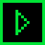
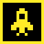
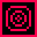
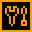
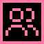
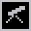
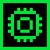

#  LAIKA PROGRAM — Space Mission Design Game

An 8-bit space mission design and astronaut operations game built for the **NASA Space Apps Challenge** (*Space Mission Design Game / Mission Astronaut*). Written in pure **HTML5, CSS3 and JavaScript (ES modules)** with no external libraries and no build step. Missions, rockets, components, crew and events live in `data/*.json`.

 **Play online:** https://laika-program.vercel.app

You play as **Laika**, Flight Director, guiding **17 cartoon animal astronauts** (**8 roles**, **9 species**) inspired by the real animals that flew to space: Belka, Strelka, Zvezdochka, Ham, Enos, Albert II, Héctor, Félicette, Marfusha, Miss Baker, Able, Arabella, Gordo, Veterok, Ugolyok, Chernushka and the Zond 5 tortoises (Zondy). Crew portraits are drawn in SVG (`js/views/animals.js`) and converted to 40×40 PICO-8 sprites at startup.

>  **Language — `EN | ES`:** the game starts in **English** by default. The `EN | ES` switch on the start screen applies to the whole game, including the embedded STS-125 minigames (`js/i18n.js`, `js/i18n-en.js`).

---

##  How to Run & Publish

The game loads `data/*.json` with `fetch()`, so it needs an HTTP server (opening `index.html` directly from disk will not work):

```bash
# Option 1 (Python)
python3 -m http.server 8000      # then open http://localhost:8000

# Option 2 (Node.js)
npx serve .

# Option 3: VS Code "Live Server" extension
```

**Hosting:** it is a static site, so it can be published as-is. The live version runs on **Vercel** (Framework Preset: *Other*, no build command, output = repository root). GitHub Pages or itch.io (HTML project) also work.

---

##  Missions (`data/levels.json`)

| Mission | Destination | Status | Rocket | Payload cap | Crew seats | Minimum to launch | Science goal |
|---|---|---|---|---|---|---|---|
| **1. Save the Hubble (STS-125)** | Low Earth Orbit (`LEO`) | **Playable** | Cóndor L | 8,000 kg | Commander, Pilot, Specialist (spacewalks) | Engine 1 · Shield 1 · Science 50 % | 500 |
| **2. Expedition to the Moon** | Lunar south pole (`MOON`) | Coming soon | Jaguar H | 18,000 kg | Commander, Pilot, Science | Engine 2 · Shield 1 · Science 50 % | 600 |
| **3. Crewed mission to Mars** | Mars (`MARS`) | Coming soon | Titán SH | 30,000 kg | Commander, Pilot, Engineering, Medical, Science | Engine 3 · Shield 2 · Science 50 % | 1,200 |

Mission 1 has **6 main objectives** based on the real STS-125 mission (May 2009): catch the Hubble → new camera (1st spacewalk) → gyroscopes (2nd spacewalk) → STIS repair (4th spacewalk) → release the Hubble → **land at home** (always the last objective; the mission ends when you land).

---

##  Gameplay Loop

1.  **Mission briefing card (before launch).** A real NASA photo of the STS-125 crew with the facts of the real mission (Atlantis, May 11, 2009, commander, pilot and specialists).
2.  **Hangar — build your ship (`js/views/hangarView.js`, `js/ship.js`).**
   - Pick parts in **6 categories**: Cabin, Engine, Power, Antenna, Shield and Science instruments. Batteries, Life Support, Flight Computer and Attitude Control are set automatically.
   - Five status bars (Weight, Power, Engine, Protection, Science) show a **MIN / MAX marker**: the launch button stays locked until every bar meets its marker (weight under the rocket's capacity, power ≥ consumption, minimum engine and shield, at least 50 % of the science goal).
   - Laika explains every part and every bar (tap the `?`).
3.  **Crew selection (`js/views/crewView.js`).** One animal astronaut per seat, compared with skill bars (**Speed, Analysis, Technical, Calm**), short real-history bios and a team radar chart. Everything fits on one screen.
4.  **Launch (`js/views/flightView.js`).** One-button ascent (`Space`, click or tap; or **Skip**):
   - live **speed and altitude** readout (≈ 1,000 km/h at Max Q, ≈ 8,000 km/h at first-stage separation, ≈ 27,000 km/h in orbit);
   - keep the throttle in the green zone, ease off at **Max Q**, separate the stage on time and fire the engine to enter orbit. Heavier ships get a narrower green zone; stronger engines get a bigger orbit-burn target.
5.  **Mission operations (`js/views/missionView.js`, `js/missionEngine.js`, `js/views/orbitMap.js`).**
   - Pixel-art **Earth with real continents**, a white orbit path, the pixel-art **Hubble** and **your own ship** drawn in the same 8-bit style, plus your ship's **live orbital speed** (≈ 27,300 km/h, like the Hubble).
   - **Main objectives = STS-125 minigames** (`minigames/sts125/`), played inside the mission:
     - *Catch the Hubble* — chase it, take a photo, grab it with the Canadarm and lower it into the bay.
     - *New camera* — loosen the stuck bolt, swap WFPC2 for **WFC3**, then align red/green/blue filters to reveal its real first photo (Butterfly Nebula).
     - *Gyroscopes & batteries* — insert 3 gyroscope boxes (the last one doesn't fit, like in real life), push a battery module (inertia!) and test Hubble's aim.
     - *Fix the spectrograph* — yank the stuck handrail, remove **111 screws** with the capture plate, swap the board and match hydrogen and sodium lines in a star's spectrum.
     - *Release the Hubble* and *Land at home* — release it gently, take the farewell photo, then land **Atlantis** at Edwards AFB with the drag chute.
     - Each minigame ends with a 3-star rating (average of its steps); most of them also include a short quiz.
   - **Ship repairs (`js/views/repairGame.js`):** 10 failures fixed through 4 one-button mechanics (aim, charge, tap, patch).
   - **Crew dispatch:** events open a simple window with **the problem, the radar chart and who to send** — the team's blue shape must cover the yellow requirement shape. Fatigue and temporary states (blackout, comms down, sensors failing, crew member out) affect the mission.
   - **Simple alerts:** Laika gives the instructions; results appear as small icons, and a failure makes the screen edges pulse red twice, slowly and softly (photosensitivity-safe; respects *reduced motion*).
6.  **Final report (`js/report.js`, `js/views/reportView.js`).** Grade **A–F** out of 100 (**main objectives 35, science 25, ship integrity 15, random events 25**), short reasons, a tip from Laika and a real NASA mission card with photo — all on one screen — plus **Improve my ship and try again**.

---

##  Architecture & 8-Bit Style

- **Logic separated from views:** `js/ship.js`, `js/missionEngine.js` and `js/report.js` do not touch the DOM; views under `js/views/` read the state and draw the UI.
- **Pixel art:** 16-color PICO-8 palette (`css/retro.css`, `css/fixes.css`) and canvases drawn at 1/3 resolution (`PX = 3`).
  - `js/views/pixelEarth.js` + `js/earthMap.js`: rotating Earth with real continents, polar ice, deserts, clouds and a dithered night side.
  - `js/views/pixelShip.js`: turns any ship you build into shaded pixel art (light from the Sun, dithered shadows, outline) and draws the pixel-art Hubble.
- **Languages:** `js/i18n.js` translates every on-screen and canvas text with the Spanish → English dictionary in `js/i18n-en.js` (shared with the minigames). New texts need an entry there to appear in English.
- **Fonts, icons & sound:** bundled *Press Start 2P* and *VT323* (SIL OFL 1.1), *Pixelarticons* (MIT) plus custom icons (`js/icons.js`), and Web Audio chiptune effects (`js/sfx.js`).
- **Balance simulator (`tools/simulate.mjs`):**
  ```bash
  node tools/simulate.mjs 200
  REACTION=5 node tools/simulate.mjs 300
  ```

---

##  NASA & Partner Open Data Used

- **NASA STS-125 & Hubble Servicing Mission 4:** real Atlantis crew, spacewalk dates and durations, WFC3 / gyroscopes / batteries / STIS tasks, Edwards AFB landing (12 days, 21 h, 37 min; 8.5 million km) — [STS-125](https://www.nasa.gov/mission/sts-125/), [SM4](https://science.nasa.gov/mission/hubble/observatory/missions-to-hubble/servicing-mission-4/), [NASA Goddard SM4 archive](https://asd.gsfc.nasa.gov/archive/sm4/multimedia/gallery10_space-day3.html).
- **NASA Image and Video Library (`images.nasa.gov`):** public-domain photos (`S125-E-…`, `STS125-S-…`) in `assets/hubble/` and `minigames/sts125/shared/img/`.
- **ESA/Hubble:** first images after the repair — Butterfly Nebula, Stephan's Quintet, Carina Nebula ([heic0910](https://esahubble.org/news/heic0910/)) — and the 1995 *Pillars of Creation* (WFPC2).
- **NASA Hubble today:** one-gyro mode since June 2024 and the 35th anniversary (≈ 1.7 million observations by February 2025).
- **Canadian Space Agency (CSA):** the 15 m Canadarm used to grapple and release the Hubble.
- **Natural Earth** (public domain): land outlines used to draw the pixel-art Earth.
- **NASA Artemis & Moon to Mars:** constraints for the upcoming Moon and Mars missions.

Times, distances and forces are simplified for gameplay; mission names, dates, crew and facts are real.

---

##  Project Documentation (`documentation/`)

- [`documentation/analysis.md`](documentation/analysis.md) — project overview, challenge alignment and code organization.
- [`documentation/technical_aspects.md`](documentation/technical_aspects.md) — technical and game design reference.
- [`documentation/pre_final_submission.md`](documentation/pre_final_submission.md) — ready-to-paste NASA Space Apps submission copy.
